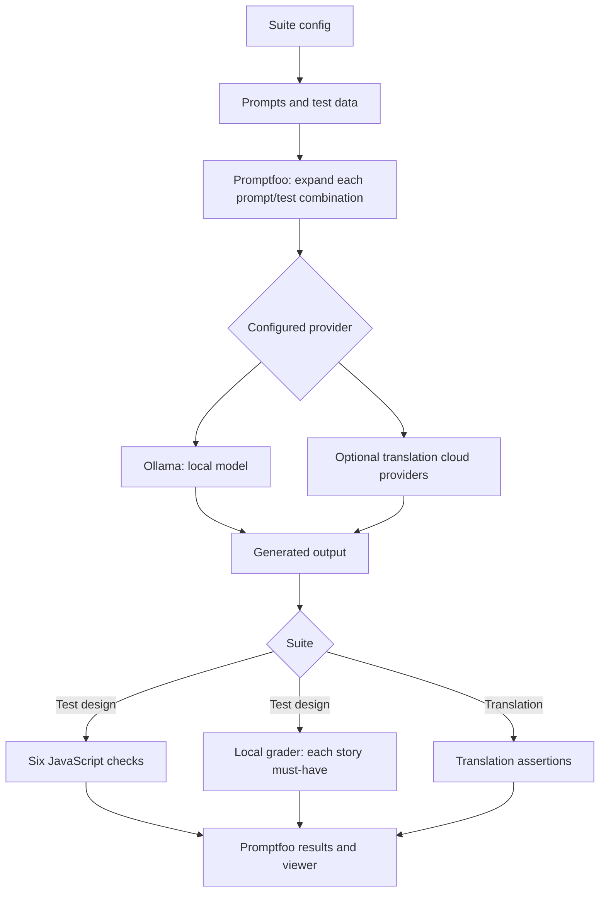
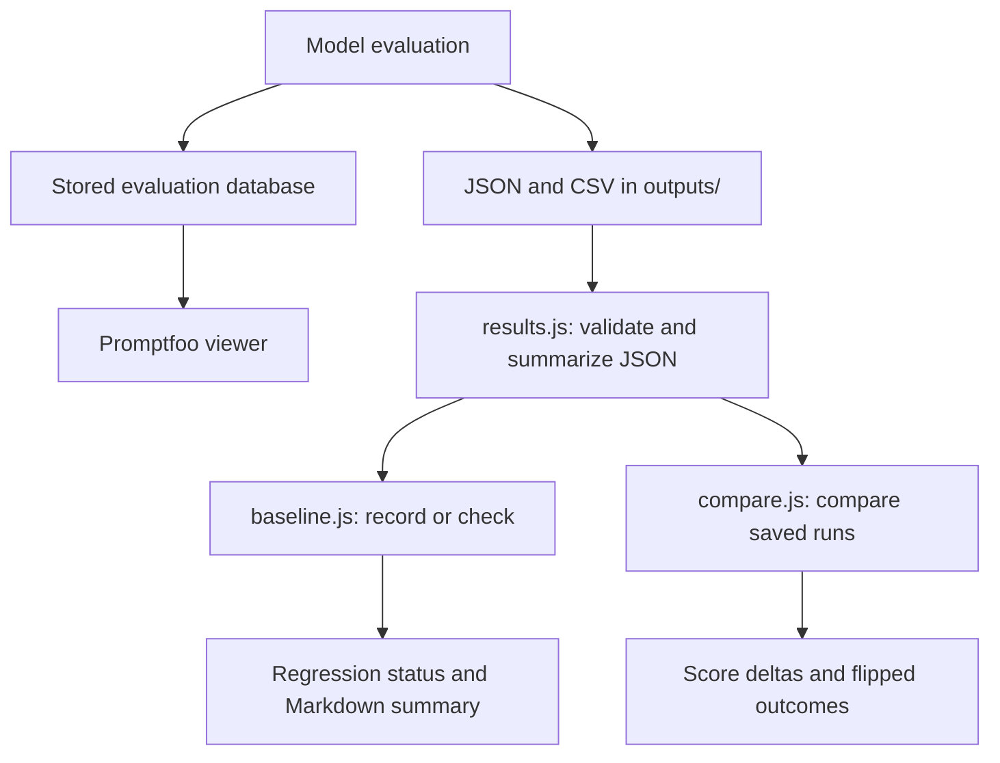

# Architecture

The repository evaluates two kinds of output: test cases generated from user stories and translations. Promptfoo owns prompt expansion, provider calls, assertion execution and reports. The JavaScript modules supply deterministic checks and saved-run analysis; they do not host a model or application server.

## Components

| Component | Responsibility |
| --- | --- |
| `promptfooconfig.test-design.yaml` | Two generation providers, two prompts, shared JavaScript checks, grader provider and output paths |
| `tests/test-design/stories.yaml` | Five stories with acceptance criteria, criterion IDs, limit flags and 19 story-specific must-have assertions |
| `prompts/test-design/` | Basic and technique-guided generation instructions and JSON shape |
| `tests/test-design/checks.js` | Parse output and return `{ pass, score, reason }` for the six deterministic metrics |
| `promptfooconfig.yaml`, `promptfooconfig.full.yaml` | Local-only and local-plus-cloud translation provider matrices |
| `prompts/`, `tests/translations.yaml`, `tests/edge_cases.yaml` | Translation strategies and assertion data |
| `scripts/results.js` | Read Promptfoo JSON and group scores/outcomes by provider, prompt and test |
| `scripts/baseline.js`, `scripts/compare.js` | Regression decisions against a saved baseline and before/after score differences |

The [README](../README.md#how-the-suites-work) retains the metric definitions, suite counts and benchmark findings. The [customization guide](customizing.md) owns provider, test and prompt examples.

## Generation and grading

Test-design generation uses `qwen3.8:27b-mlx` and `qwen3.6:35b-mlx` at temperature 0.2. The default grader is `qwen3.8:27b-mlx` at temperature 0. Each generated response is assessed by both code and story-specific model assertions; the code layer is not a routing gate that substitutes for grading. The grader's self-grading bias remains explicit in the [README](../README.md#test-design-suite-results-2026-09-26-apple-m4-max-64-gb).

The deterministic parser accepts a JSON object, including an object inside a code fence or surrounding text. It reads the `test_cases` array. Malformed output yields failed assertion results rather than a successful evaluation. Assertions examine structure, criterion coverage, negative/boundary categories, expected-result specificity and duplicate titles; category labels and coverage declarations do not independently prove test quality. The grader supplies the second assessment layer.

`evaluateOptions.maxConcurrency: 2` bounds test-design evaluation concurrency. Ollama queues requests per model; raising concurrency can increase queueing and timeouts. Every local provider, including the grader, uses `think: false` to keep reasoning out of the expected answer. Preserve these settings when doing maintenance.

Translation uses three prompts and 45 test records, yielding 135 prompt/test combinations for the single local provider. The full config adds five cloud provider entries. Provider IDs, temperatures and keys are documented in [customizing](customizing.md#cloud-providers); adding cloud providers changes prerequisites and may incur cost.

## Saved-run analysis

Normal evaluations persist to Promptfoo's local database as well as exporting files. The viewer reads that database; a JSON export alone does not populate it. Verification runs using `--no-write` only export their requested files.

`results.js` requires `results.results` to be an array. A run is one provider and one prompt; configured prompt labels stabilize keys when Promptfoo expands file prompt labels. Test descriptions, falling back to serialized variables, identify test outcomes. Failed/error responses count against the pass rate. Named metrics are averaged and scores are rounded to three decimals.

A baseline records per-run pass rate and metrics, timestamp, available Promptfoo version and tolerance. Default tolerance is `0.05`, or five percentage points. A drop beyond tolerance, missing recorded run or missing metric fails the check; a missing baseline also fails. Updating retains an existing tolerance. A check can write a Markdown summary to `GITHUB_STEP_SUMMARY` when set. `compare` reports score deltas and tests present in both runs whose outcome flipped; it is an inspection tool, not the baseline regression gate.

Keep runs comparable: use the same machine, models and configurations, and inspect new outputs before accepting a baseline. Run the comparison commands in the [README](../README.md#baselines-and-comparing-runs). Saved results and baselines under `outputs/` stay local and ignored.

## Boundaries and trade-offs

- Unit tests exercise assertion and result-analysis behavior without models. They cannot establish generation quality or grader correctness.
- Local evaluation calls the Ollama service; optional full translation evaluation also calls hosted provider APIs. Models must already be available. A native MLX model tag is an Apple Silicon choice, not a cross-platform binary guarantee.
- `npm run report` starts the local Promptfoo viewer. `npm run publish` explicitly shares a run externally; it is not part of CI or routine verification.
- Historical benchmark results describe their recorded date/hardware. A new dependency version or successful unit run does not refresh that evidence.
